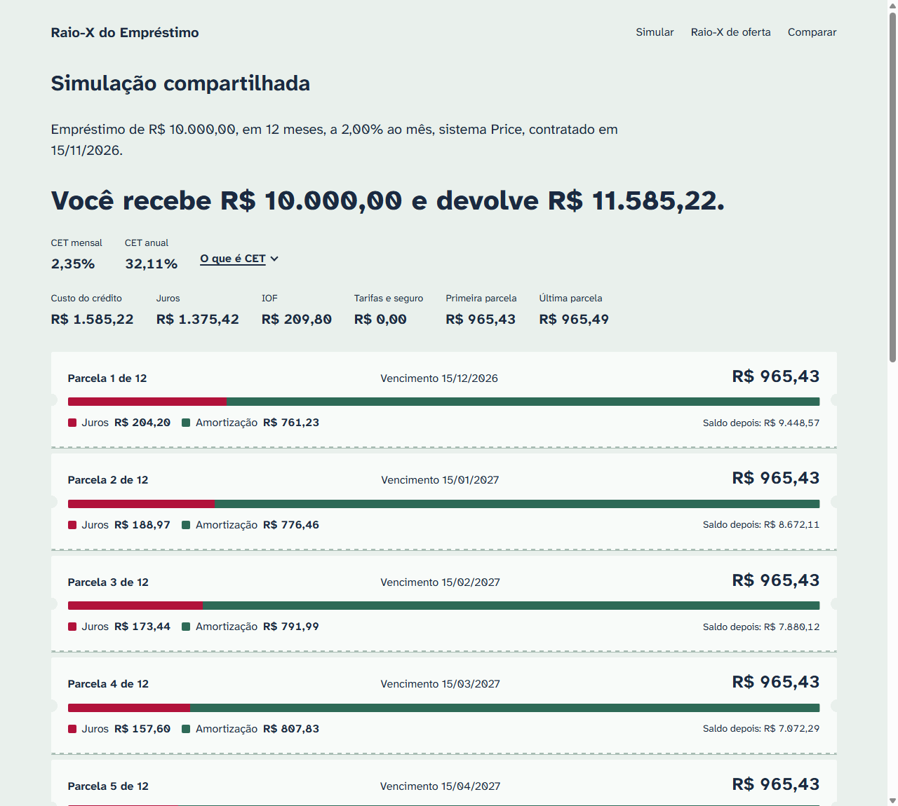
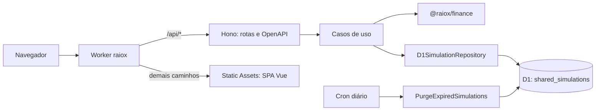

# Raio-X do Empréstimo

Ferramenta pública e gratuita que mostra quanto um empréstimo realmente custa, somando juros,
IOF e tarifas no Custo Efetivo Total (CET). Feita para quem recebeu uma oferta de crédito e quer
comparar antes de assinar.

[Design do sistema (SDD)](docs/SDD.md) | [Especificação](docs/SPEC.md) | [Arquitetura](docs/ARCHITECTURE.md) | [Design system](docs/DESIGN.md)

> A demo pública entra aqui depois do primeiro deploy (ver [Deploy](#deploy)). Por enquanto, rode localmente:
> a interface fica em `http://127.0.0.1:8787` e a documentação da API em `http://127.0.0.1:8787/api/docs`.

[](https://github.com/MateusMontan/raio-x-emprestimo/actions/workflows/deploy.yml)




## O problema

Ofertas de crédito costumam destacar a parcela e a taxa nominal. O custo real inclui IOF,
tarifas e seguros, e o consumidor raramente consegue calcular o CET sozinho. Sem esse número,
duas ofertas com parcelas parecidas podem ter custos totais bem diferentes.

## O que a ferramenta faz

- **F1 Simular:** a partir de valor, taxa mensal, prazo e sistema (Price ou SAC), mostra o
  cronograma completo, o IOF e o CET.
- **F2 Raio-X de oferta:** a partir do valor liberado, da parcela e do prazo informados pelo
  banco, descobre a taxa implícita e o CET.
- **F3 Comparar:** coloca até três cenários lado a lado e destaca o mais barato pelo CET e pelo
  total pago.
- **F4 Compartilhar:** gera um link curto com as entradas da simulação, que expira em 180 dias.
- **F5 API pública:** oferece os mesmos cálculos por uma API REST documentada em OpenAPI 3.1.

## Experimente pela API

Dinheiro trafega em centavos inteiros (`1000000` são R$ 10.000,00) e taxas em decimal (`0.02`
são 2% ao mês).

```bash
curl -X POST http://127.0.0.1:8787/api/v1/simulations/calculate \
  -H "Content-Type: application/json" \
  -d '{
    "amountCents": 1000000,
    "monthlyRate": 0.02,
    "installments": 12,
    "system": "PRICE",
    "contractDate": "2026-11-15",
    "iofMode": "NONE"
  }'
```

Trecho resumido da resposta:

```json
{
  "system": "PRICE",
  "schedule": [
    { "n": 1, "payment": 94560, "...": "..." },
    { "n": 12, "payment": 94555, "...": "..." }
  ],
  "totals": { "paidCents": 1134715, "...": "..." }
}
```

A primeira parcela é R$ 945,60 e o total pago é R$ 11.347,15. A última parcela absorve o
resíduo do arredondamento.

## Arquitetura

Um único Worker serve a API e a interface. O Cron Trigger limpa os links expirados no D1.



| Camada         | Pacote ou pasta               | Depende de             | Regra                                                           |
| -------------- | ----------------------------- | ---------------------- | --------------------------------------------------------------- |
| Domínio        | `@raiox/finance`              | nada                   | Funções puras e value objects. Toda regra financeira está aqui. |
| Contratos      | `@raiox/contracts`            | Zod                    | Schemas de entrada e saída com os limites de validação.         |
| Aplicação      | `apps/api/src/application`    | finance, contracts     | Casos de uso que dependem de ports, nunca de D1 ou Hono.        |
| Infraestrutura | `apps/api/src/infrastructure` | application            | Repositório D1, gerador de ids, relógio e limitador.            |
| HTTP           | `apps/api/src/http`           | application, contracts | Rotas, Problem Details, OpenAPI e Scalar.                       |
| Composição     | `apps/api/src/index.ts`       | tudo                   | Único ponto que cria as implementações concretas.               |

A regra de dependência aponta para dentro: o domínio não depende de nada, e a aplicação não
importa Hono nem infraestrutura. O ESLint do monorepo impõe isso.

Árvore do monorepo (pnpm workspaces):

```text
raio-x-emprestimo/
├── packages/
│   ├── finance/        # Domínio puro: Price, SAC, IOF, CET, datas. Sem I/O.
│   └── contracts/      # Schemas Zod compartilhados entre API e web.
├── apps/
│   ├── api/            # Hono no Worker: application, infrastructure, http, migrations.
│   └── web/            # Vue 3 + Vite: features por fluxo e design system Carnê.
└── docs/               # SPEC, arquitetura, convenções, design, ADRs.
```

## Decisões e trade-offs

Os ADRs completos ficam em `docs/adr/`.

- **ADR-001, plataforma.** Cloudflare Workers com D1 em vez de um host PHP ou Docker gratuito,
  que dorme ou expira o banco. Abre-se mão de 10 ms de CPU por requisição, então os algoritmos
  são O(n) com no máximo 420 parcelas.
- **ADR-002, precisão monetária.** Valores em centavos inteiros e taxas em `number`, com
  arredondamento half-even por parcela e a última parcela fechando o saldo em zero. Abre-se mão
  de aritmética decimal exata; os resultados são conferidos ao centavo contra referências.
- **ADR-003, um Worker.** API e front no mesmo deploy, sem CORS. Abre-se mão de escalar e
  publicar o front e a API separadamente.
- **ADR-004, contratos compartilhados.** Os schemas Zod ficam em `@raiox/contracts` e valem para
  API e web. Abre-se mão de ritmos independentes para front e API, já que usam o mesmo pacote.
- **ADR-005, design system próprio.** Componentes e tokens feitos no projeto, para ter identidade
  visual. Abre-se mão do ganho de tempo de uma biblioteca pronta, incluindo estados e acessibilidade.
- **ADR-006, link guarda só as entradas.** O resultado é recalculado a cada leitura. Correções
  de regra valem retroativamente, mas o número de um link pode mudar se a regra mudar.

Decisões de implementação:

- **Fonte auto-hospedada.** A Atkinson Hyperlegible Next vem do pacote `@fontsource`, sem
  requisição a servidores de terceiros.
- **Limite de taxa na gravação.** `POST /api/v1/simulations` aceita 10 requisições por minuto por
  IP, com um binding de rate limit da Cloudflare. A resposta excedente é 429 com `Retry-After`.
- **Erros em Problem Details.** Erros seguem a RFC 9457 em `application/problem+json`. Falhas de
  validação são 422 com `errors[]` apontando cada campo.
- **Link expirado com 404 de verdade.** `GET /s/:id` responde 404 com a página amigável da
  interface, em vez de 200 com uma mensagem de erro.
- **Links enxutos e com validade.** Cada link guarda só as entradas validadas e expira em 180 dias.
  Um Cron Trigger diário remove os expirados.

## Regras de cálculo e fontes

- **Price (R1):** parcelas fixas pelo sistema francês de amortização. Matemática financeira clássica.
- **SAC (R2):** amortização constante, com juros sobre o saldo devedor. Matemática financeira
  clássica; a especificação não cita norma específica.
- **IOF (R3):** alíquotas diária e adicional para pessoa física. Decreto nº 6.306/2007, art. 7º.
  As alíquotas ficam numa política de tributos versionada, com vigência e link da norma, então
  uma mudança é só uma nova versão.
- **CET (R4):** taxa anual que iguala o valor liberado ao valor presente das parcelas, com datas
  reais. Resolução CMN nº 3.517/2007, fórmula do anexo.
- **Taxa implícita (R5):** a taxa mensal que resolve a Price para os valores informados pelo banco.
  Usa o mesmo solver do CET.
- **Datas (R6):** vencimentos no mesmo dia do mês, com o último dia do mês quando faltar. Datas
  sem hora, no formato ISO. Convenção da especificação, sem norma externa.

## Qualidade

São 371 testes automatizados, todos rodando no CI: 117 no domínio (com cobertura mínima de 95% exigida),
57 nos contratos, 83 na API e 114 na interface.

- **Domínio:** casos conferidos à mão, com tabelas de referência e um teste de desempenho para
  420 parcelas.
- **Casos de uso:** testados com fakes em memória para o repositório, o relógio e os ids.
- **Rotas:** testadas com `app.request`, sem subir servidor.
- **Repositório:** testado contra um D1 local via Miniflare, com a migration real.
- **Interface:** componentes críticos testados com Vitest e Vue Test Utils.
- **Lint e formatação:** ESLint em modo estrito com typescript-eslint, Prettier, typecheck e testes
  rodados pelo `ci.yml` em cada pull request.
- **Regra de arquitetura:** o ESLint proíbe que a aplicação importe Hono ou infraestrutura, e que a
  camada HTTP importe infraestrutura.

## Como rodar localmente

Pré-requisitos: Node 22 e pnpm.

```bash
pnpm install

# Aplica a migration no D1 local do Wrangler
pnpm --filter @raiox/api db:migrate:local

# A API serve o build da web (apps/web/dist), então gere-o uma vez
pnpm --filter @raiox/web build

# Terminal 1: API e Worker na porta 8787
pnpm --filter @raiox/api dev

# Terminal 2: interface em modo de desenvolvimento
pnpm --filter @raiox/web dev
```

Verificações:

```bash
pnpm lint
pnpm typecheck
pnpm test
```

## Deploy

O workflow `deploy.yml` roda a cada push na `main`. Ele executa as verificações, aplica as
migrations no D1 remoto e publica o Worker com `wrangler deploy`.

Secrets necessários no repositório:

- `CLOUDFLARE_API_TOKEN`
- `CLOUDFLARE_ACCOUNT_ID`

Tudo roda no plano gratuito da Cloudflare: Workers, Static Assets, D1 e Cron Triggers.

## Como foi construído

A especificação, a arquitetura e as convenções foram escritas antes do código. Um agente
principal planeja o trabalho e escreve um briefing curto para cada módulo. Um subagente
implementador escreve o código e os testes desse módulo. Depois, um subagente revisor, com
contexto limpo, recebe só a especificação e o diff, e aponta defeitos. O autor decide o que
aceitar e valida o resultado com lint, typecheck e testes. O código foi escrito por subagentes de
IA; as decisões de regra, arquitetura e escopo são do autor.

## Fora do escopo da v1

- Login e histórico por usuário.
- Carência.
- Taxas pós-fixadas.
- Financiamento imobiliário (SFH e SFI).
- Consignado com margem.

Esta é uma simulação educativa. Ela não substitui o contrato do banco nem aconselhamento financeiro.
