# SDD: Raio-X do Empréstimo (v1)

Documento de design de software. Descreve como o código realiza a SPEC (`docs/SPEC.md`) e a ARCHITECTURE (`docs/ARCHITECTURE.md`). Quando o código diverge de um documento, este SDD descreve o código e registra a divergência na seção 16.

Estado descrito: repositório em 2026-11-15, com `@raiox/finance`, `@raiox/contracts`, `apps/api` e `apps/web` implementados. F1 a F5 estão no código, inclusive a tela Comparar. A pipeline de CI e deploy está em `.github/workflows/`.

## 1. Introdução

### 1.1 Propósito

Este documento serve a quem vai manter ou avaliar o sistema sem ter visto o código. Ele explica a organização em camadas, o comportamento de cada caso de uso, o modelo de dados, o contrato HTTP, a estratégia de testes e a implantação.

### 1.2 Escopo do sistema (v1)

O sistema é uma ferramenta pública e gratuita que mostra quanto um empréstimo custa de verdade. Ele entrega cinco funcionalidades, definidas na SPEC, seção 3:

- F1 Simular: cronograma, IOF e CET a partir de valor, taxa, prazo e sistema.
- F2 Raio-X de oferta: taxa implícita e CET a partir do valor liberado, da parcela e do prazo.
- F3 Comparar: até três cenários lado a lado.
- F4 Compartilhar: link curto `/s/:id` que guarda só as entradas.
- F5 API pública: os mesmos cálculos em REST, com OpenAPI 3.1 em `/api/docs`.

Ficam fora da v1: login, histórico por usuário, carência, taxas pós-fixadas, financiamento imobiliário e consignado (SPEC, seção 3).

Situação no código: F1 a F5 estão implementadas. A tela Comparar (F3) é descrita na seção 10.9 e o fluxo na seção 7.7.

### 1.3 Documentos relacionados

| Documento | Conteúdo |
|-----------|----------|
| `docs/SPEC.md` | Requisitos funcionais (F1 a F5), regras de cálculo (R1 a R7), requisitos não funcionais e critérios de aceite. |
| `docs/ARCHITECTURE.md` | Monorepo, camadas, rotas planejadas e modelo de dados. |
| `docs/adr/README.md` | Decisões arquiteturais ADR-001 a ADR-006 (resumidas na seção 15). |
| `docs/DESIGN.md` | Conceito, tokens, layout e voz do design system "Carnê". |
| `docs/CONVENTIONS.md` | Convenções de código: nomes em inglês, textos em pt-BR, Conventional Commits. |

As regras são referenciadas como "SPEC, R3" e assim por diante. Este documento não repete as fórmulas.

### 1.4 Glossário

- **CET (Custo Efetivo Total):** taxa anual que iguala o valor liberado ao valor presente de tudo que o cliente paga. Inclui juros, IOF e tarifas.
- **IOF (Imposto sobre Operações Financeiras):** tributo sobre crédito. Tem uma parte diária, proporcional aos dias, e uma parte adicional fixa.
- **Price:** sistema de amortização com parcelas iguais (sistema francês).
- **SAC (Sistema de Amortização Constante):** amortização igual em todas as parcelas, de modo que as parcelas diminuem.
- **Taxa implícita:** taxa mensal que faz a parcela informada pelo banco pagar exatamente o valor liberado.
- **Lâmina / carnê:** cada parcela do cronograma é uma lâmina, como um boleto destacável. O conjunto de lâminas é o carnê.
- **Port:** interface definida pela camada de aplicação para algo que ela precisa (repositório, relógio, gerador de id). A implementação concreta fica na infraestrutura.
- **Caso de uso:** classe da camada de aplicação que executa uma operação de negócio. Recebe os ports pelo construtor e devolve um resultado ou lança um erro.

## 2. Contexto e visão geral

### 2.1 Diagrama de contexto

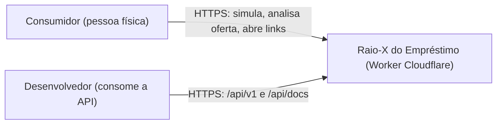

### 2.2 Diagrama de contêineres

Há um único Worker. Ele serve a API Hono em `/api/*`, os links `/s/:id` e os arquivos estáticos da SPA. O D1 guarda só os links compartilhados. O Cron Trigger faz a limpeza diária. O binding de rate limit protege o compartilhamento.

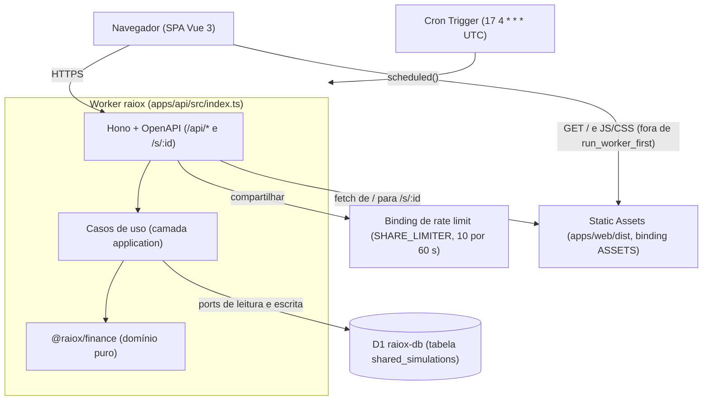

O Worker tem `run_worker_first: ["/api/*", "/s/*"]` (`apps/api/wrangler.jsonc`). Todas as outras requisições vão direto aos assets, com fallback para `index.html` (`not_found_handling: single-page-application`).

## 3. Requisitos atendidos

| Requisito | Componentes que o realizam |
|-----------|----------------------------|
| F1 Simular (SPEC, seção 3) | `simulateLoan` (`packages/finance/src/loan/simulateLoan.ts`), `CalculateSimulation`, rota `POST /api/v1/simulations/calculate`, `SimulatePage` e `useSimulation` na web. |
| F2 Raio-X de oferta | `analyzeOffer` e `ImplicitRateSolver`, `AnalyzeOffer`, rota `POST /api/v1/offers/analyze`, `AnalyzePage` e `useOfferAnalysis`. |
| F3 Comparar | `ComparePage`, `AddOfferSection`, `ComparisonTable`, `useComparison` (lista em sessionStorage), `useScenarioResults` (uma busca por cenário), `normalizeResult`, `bestBy` e `comparisonSummary`. O botão "Comparar com outra oferta" (`AddToComparison`) fica nas telas Simular e Raio-X. Limite de `MAX_COMPARE_SCENARIOS = 3` em `@raiox/contracts`. |
| F4 Compartilhar | `ShareSimulation`, `GetSharedSimulation`, `CheckSharedSimulation`, `D1SimulationRepository`, `CryptoIdGenerator`, rotas `POST /api/v1/simulations`, `GET /api/v1/simulations/{id}` e `GET /s/:id`. |
| F5 API pública | Rotas em `apps/api/src/http/routes`, documento gerado por `OPENAPI_DOCUMENT` e interface Scalar em `/api/docs`. |
| R1 a R6 (regras de cálculo) | `packages/finance`: `PriceSchedule`, `SacSchedule`, `IofCalculator`, `financing.ts`, `CetCalculator`, `ImplicitRateSolver`, `IsoDate`. |
| R7 (limites de entrada) | `packages/contracts/src/limits.ts` e os schemas de `amounts.ts`, `primitives.ts` e `simulation.ts`. A mesma validação roda na API e no front. |
| NFR custo zero | Um Worker, Static Assets, D1 e Cron Trigger, todos no plano gratuito. |
| NFR desempenho (5 ms de CPU) | Algoritmos O(n) com n até 420 e teste de benchmark em `packages/finance/src/loan/perf.test.ts` (seção 12). |
| NFR acessibilidade | Skip link, foco no `h1` ao trocar de página, `aria-live`, `aria-invalid` e `details` para termos (seção 10). |
| NFR privacidade | Só entradas guardadas, expiração de 180 dias (`SHARE_TTL_DAYS`), limpeza diária pelo Cron (seção 8). |
| NFR precisão | Centavos inteiros em `Money` e arredondamento half-even (ADR-002, seção 5.5). |
| NFR qualidade | Cobertura mínima de 95% no `@raiox/finance` (`vitest.config.ts`). Lint, typecheck e testes em `pnpm -r`. |

## 4. Arquitetura lógica

### 4.1 Camadas

| Camada | Onde está | Responsabilidade | Depende de |
|--------|-----------|------------------|------------|
| Domínio | `packages/finance` | Funções puras e value objects: `Money`, `Rate`, `IsoDate`, estratégias de amortização, IOF, CET e taxa implícita. Sem I/O. | nada (o `package.json` não tem `dependencies`) |
| Contratos | `packages/contracts` | Schemas Zod de entrada e saída, limites da R7, mensagens em pt-BR e Problem Details. | zod |
| Aplicação | `apps/api/src/application` | Casos de uso e ports. Não conhece Hono nem D1. | finance, contracts |
| Infraestrutura | `apps/api/src/infrastructure` | Adapters: `D1SimulationRepository`, `CryptoIdGenerator`, `SystemClock`, `CloudflareRateLimiter`. | application (ports), contracts (tipo) |
| HTTP | `apps/api/src/http` | Rotas Hono, middlewares, erros em Problem Details, OpenAPI e Scalar. | application, contracts |
| Composição | `apps/api/src/index.ts` e `scheduled/` | Único lugar que instancia as implementações concretas e expõe `fetch` e `scheduled`. | tudo |
| Front-end | `apps/web` | SPA Vue 3. Consome `@raiox/contracts` e nunca importa `@raiox/finance`. | contracts |

### 4.2 Regra de dependência

As dependências apontam para dentro: HTTP e infraestrutura dependem da aplicação, e a aplicação depende do domínio e dos contratos. O domínio não depende de nada. A composição é a única exceção, porque conhece todas as camadas para montar o grafo.

### 4.3 Como a regra é imposta

A regra é verificada pelo ESLint (`eslint.config.js`, flat config com `typescript-eslint` no modo `strictTypeChecked`). Há duas restrições com `no-restricted-imports`:

- Em `apps/api/src/application/**`: proibido importar `hono`, `hono/*` e `@hono/*`, e proibido importar caminhos com `**/infrastructure/**` ou `**/http/**`. A camada de aplicação só conhece ports.
- Em `apps/api/src/http/**`: proibido importar `**/infrastructure/**`. A camada HTTP só conhece application e contracts.

O `@raiox/finance` não tem regra de ESLint própria. Sua pureza vem da ausência de dependências no `package.json`. Por convenção, o pacote não declara dependências de runtime, e a camada de domínio fica sem I/O.

Os testes dos casos de uso usam fakes em `apps/api/src/application/testing/` (ver seção 13), o que confirma a inversão de dependência na prática.

### 4.4 Dependências entre pacotes e camadas

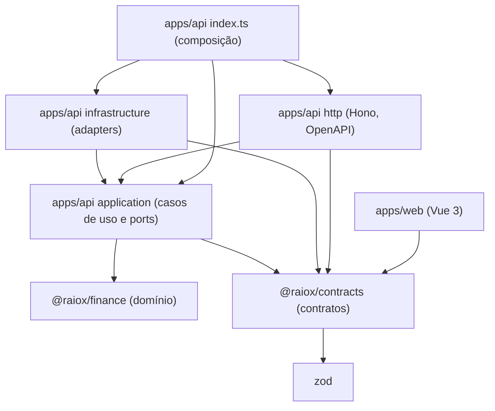

## 5. Design do domínio (@raiox/finance)

### 5.1 Entradas e saídas da facade

`simulateLoan(input: LoanInput): SimulationResult` (`loan/simulateLoan.ts`) e `analyzeOffer(input: OfferInput): OfferAnalysis` (`loan/analyzeOffer.ts`) são as duas facades públicas, exportadas por `packages/finance/src/index.ts`. Os tipos ficam em `loan/types.ts`. Os valores monetários entram e saem em centavos inteiros. As taxas são `number` decimais (0,02 = 2% a.m.).

### 5.2 Value objects

- `Money` (`money/Money.ts`): guarda `cents: number`, sempre inteiro seguro. Construtores `fromCents` (valida `Number.isSafeInteger`), `fromReais` (converte com half-even) e `fromExactCents` (arredonda um valor fracionado uma única vez). Operações: `add`, `subtract`, `multiply` e `divide` com arredondamento half-even. `ZERO` é constante.
- `Rate` (`rate/Rate.ts`): taxa mensal. `Rate.monthly` rejeita valores não finitos e valores `<= -1`. `interestOn(balance)` devolve `balance.multiply(monthly)`, ou seja, juros já arredondados ao centavo.
- `IsoDate` (`date/IsoDate.ts`): data sem hora, no formato `YYYY-MM-DD`. Valida o formato e o calendário (inclusive anos bissextos). `addDays` usa UTC. `addMonths` sempre parte da data original e limita o dia ao último do mês, então 31/jan + 2 meses resulta em 31/mar. `daysUntil` devolve dias corridos. Por usar só UTC, nada depende do fuso do servidor (SPEC, R6).

### 5.3 Estratégias de amortização

A interface `AmortizationStrategy` (`amortization/types.ts`) tem `system` e `plan(principal, rate, installments): Installment[]`. Cada `Installment` tem `n`, `interest`, `principal`, `payment` e `balance`, todos como `Money`.

- `PriceSchedule` (`amortization/PriceSchedule.ts`): calcula a parcela fixa pela fórmula da SPEC, R1, com `principal.multiply(i / (1 - (1 + i)^-n))`. Quando a taxa é zero, divide o principal pelo número de parcelas. Para cada linha, os juros são o saldo vezes a taxa, e a amortização é a parcela menos os juros. A última linha usa como amortização o saldo restante, então o saldo fecha em zero.
- `SacSchedule` (`amortization/SacSchedule.ts`): amortização fixa `principal / n`, arredondada uma vez. Juros sobre o saldo de cada período. A última linha absorve o resíduo.
- `strategyFor(system)` (`amortization/strategyFor.ts`): mapa de `AmortizationSystem` para a instância da estratégia. Adicionar um sistema (por exemplo, SACRE) significa criar uma classe que implementa a interface e incluí-la no mapa. Nenhum código existente muda, o que atende ao princípio aberto/fechado descrito em `ARCHITECTURE.md`.

### 5.4 IOF com política versionada

- `TaxPolicy` (`tax/TaxPolicy.ts`): `id`, `validFrom`, `dailyRate`, `additionalRate`, `maxDays` e `legalReference` (título e URL da norma).
- `TAX_POLICIES` (`tax/taxPolicies.ts`): hoje há uma única versão, `br-iof-pf-credito-decreto-6306`, com vigência desde 2022-01-01, alíquota diária de 0,000082, adicional de 0,0038 e limite de 365 dias. O arquivo registra que versões anteriores a 2022 não são modeladas.
- `taxPolicyFor(asOf, policies)` (`tax/taxPolicyFor.ts`): escolhe a versão com a `validFrom` mais recente que não é posterior à data do contrato. Se nenhuma serve, lança `TaxPolicyNotFoundError`.
- `IofCalculator` (`tax/IofCalculator.ts`): `dailyExact(amortization, days)` devolve `cents * dailyRate * clamp(days, 0, maxDays)` sem arredondar. `additionalExact(principal)` devolve `cents * additionalRate`, também sem arredondar. Mudar uma alíquota exige só uma nova entrada em `TAX_POLICIES`.

O cálculo de IOF financiado é um ponto fixo, em `loan/financing.ts`. O principal começa como o valor pedido. Em cada iteração, `planSchedule` gera o cronograma para o principal atual, e o novo principal é `valor + IOF diário + IOF adicional`. O laço para quando a diferença entre o novo principal e o anterior é de até 1 centavo (`CONVERGENCE_CENTS = 1`). Após 100 iterações sem convergir, lança `NonConvergenceError` com a mensagem "IOF financiado não convergiu". Esse é o cumprimento da SPEC, R3.

### 5.5 Arredondamento e resíduo (ADR-002)

`roundHalfEven` (`money/roundHalfEven.ts`) arredonda empates para o inteiro par. Isso evita viés acumulado nas parcelas.

Na implementação, o arredondamento acontece em dois lugares:

- Os juros de cada parcela são arredondados ao centavo por linha (`Rate.interestOn`).
- O IOF diário é somado sem arredondar por linha (`planSchedule` acumula `dailyExact`) e arredondado uma única vez no total. O IOF adicional também é arredondado uma vez.

O resíduo vai para a última parcela. Em Price e SAC, a última amortização é o saldo restante, então o saldo final é exatamente zero. Isso fecha o cronograma em centavos, como a SPEC pede em R1 e R2.

A ADR-002 diz que o arredondamento acontece "só na fronteira de cada parcela". Na prática, o IOF é arredondado sobre o total, não por parcela. A seção 16 registra essa diferença.

### 5.6 Cronograma, liberação e totais

`loan/simulateLoan.ts` executa o fluxo:

1. `normalizeLoanInput` (`loan/validateLoanInput.ts`) valida valor positivo, tarifas não negativas, parcelas inteiras, sistema e modo de IOF conhecidos. Converte as datas com `resolveDates` (`loan/resolveDates.ts`): o primeiro vencimento padrão é a contratação mais 30 dias, e ele não pode ser anterior à contratação. As demais datas vêm de `dueDatesFrom`, que aplica `addMonths` a partir do primeiro vencimento.
2. `buildContext` monta a estratégia, a taxa, as datas, os dias de cada vencimento e o `IofCalculator`.
3. Se o IOF é financiado, `solveFinancedPlan` resolve o ponto fixo. Caso contrário, `planSchedule` gera o cronograma uma vez.
4. O valor liberado é o valor menos as tarifas. Se o IOF é à vista (`CASH`), ele também é descontado. Se o resultado não for positivo, lança `InvalidInputError`.
5. `CetCalculator` calcula o CET com o valor liberado e os fluxos das parcelas (seção 5.7).
6. `totalsFor` soma pagos, juros e principal. `costCents` é o total pago menos o valor liberado. `chargesCents` fica sempre zero na v1.

Observação: `buildContext` chama `taxPolicyFor` em todos os casos, inclusive com IOF `NONE`. Por isso, um contrato anterior a 2022 falha mesmo sem IOF (ver seção 16).

### 5.7 CET e taxa implícita (ADR-002, R4 e R5)

`solver/findRoot.ts` implementa o solver comum. Ele tenta Newton-Raphson com tolerância de 1e-10 e no máximo 100 iterações. A derivada é analítica quando fornecida, ou uma diferença central caso contrário. Se o Newton sair do intervalo, divergir, tiver derivada zero ou esgotar as iterações, o solver usa bisseção no intervalo `[lower, upper]`. A bisseção lança `NonConvergenceError` se os extremos não tiverem sinais opostos.

`CetCalculator` (`cet/CetCalculator.ts`) normaliza os fluxos pelo valor liberado. Cada fluxo tem peso `amount / released` e prazo `days / 365`. A função resíduo é `valor presente(taxa) - 1`. Um limite superior é achado por duplicação a partir de 1, até o resíduo ficar não positivo, com teto de 1e18. O intervalo é `[-0,99999, limite]`, com chute inicial de 0,3. O resultado anual vai em `annual`, e o mensal é `(1 + annual)^(1/12) - 1`.

`ImplicitRateSolver` (`offer/ImplicitRateSolver.ts`) busca a taxa mensal `i` que satisfaz `valor liberado / parcela = a(i)`, onde `a(i) = (1 - (1 + i)^-n) / i`. A função `annuityFactor` usa `expm1` e `log1p` para manter a precisão perto de zero. O intervalo vai até 1e6, com chute inicial de 0,01. Como não há derivada analítica, o solver usa diferença central.

### 5.8 Diagrama de classes do domínio

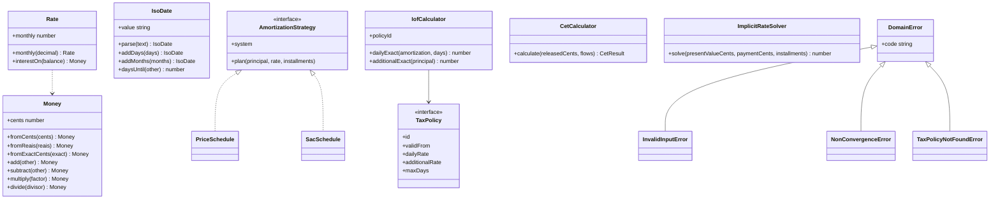

### 5.9 Erros de domínio e seus códigos

Todo erro de domínio é uma subclasse de `DomainError` (`errors.ts`), com um `code` estável que pode ser exposto ao cliente.

| Classe | `code` | Quando é lançada |
|--------|--------|------------------|
| `InvalidInputError` | `INVALID_INPUT` | Pré-condição violada (valor não positivo, parcelas não inteiras, data inexistente, primeiro vencimento anterior à contratação, valor liberado não positivo após IOF e tarifas). |
| `NonConvergenceError` | `NON_CONVERGENCE` | Solver sem raiz no intervalo ou IOF financiado sem convergir em 100 iterações. |
| `TaxPolicyNotFoundError` | `TAX_POLICY_NOT_FOUND` | Nenhuma política de IOF vigente na data do contrato. |
| (interno) | `INTERNAL_INDEX` | `requireAt` acessou um índice fora do intervalo. Não é mapeado para o cliente. |

## 6. Contratos (@raiox/contracts)

`@raiox/contracts` é a única fonte da verdade dos DTOs, conforme ADR-004. Ele exporta schemas Zod e os tipos inferidos deles. A API usa os schemas para validar entradas e documentar as saídas no OpenAPI. A web usa os mesmos schemas para validar o formulário antes de chamar a API.

### 6.1 Limites (R7)

`limits.ts` define `LIMITS`, com os valores da SPEC, seção 4, R7:

| Campo | Mínimo | Máximo | Constante |
|-------|--------|--------|-----------|
| Valor | 10.000 centavos (R$ 100,00) | 1.000.000.000 centavos (R$ 10.000.000,00) | `amountCents` |
| Prazo | 1 | 420 | `installments` |
| Taxa mensal | 0 | 0,30 | `monthlyRate` |
| Tarifas e seguro | 0 | 50% do valor | `feesMaxRatio = 0.5` |

Também ficam no mesmo arquivo `SHARE_TTL_DAYS = 180` e `MAX_COMPARE_SCENARIOS = 3`.

### 6.2 Schemas

| Arquivo | Schemas principais | Papel |
|---------|--------------------|-------|
| `primitives.ts` | `isoDateSchema`, `simulationIdSchema`, `amortizationSystemSchema`, `iofModeSchema` | `isoDateSchema` aceita só `YYYY-MM-DD` entre 2000-01-01 e 2100-12-31 que existe no calendário. `simulationIdSchema` aceita 10 letras ou dígitos. Os sistemas são `PRICE` e `SAC`. Os modos de IOF são `FINANCED`, `CASH` e `NONE`. |
| `amounts.ts` | `amountCentsSchema`, `installmentsSchema`, `monthlyRateSchema`, `paymentCentsSchema` | Os limites numéricos da R7. A parcela da oferta vai de 1 centavo ao teto de valor. |
| `loanDates.ts` | `optionalFirstDueDateSchema`, `refineFirstDueDate` | Regra cruzada: o primeiro vencimento não pode ser anterior à contratação. Comparação lexical, que é válida para ISO. |
| `simulation.ts` | `simulationInputSchema`, `simulationResultSchema` | Entrada da F1 e saída do cálculo. |
| `offer.ts` | `offerInputSchema`, `offerAnalysisSchema` | Entrada e saída da F2. |
| `share.ts` | `shareResponseSchema`, `sharedSimulationSchema` | Resposta ao compartilhar (`id`, `url`, `expiresAt`) e leitura compartilhada (`id`, `createdAt`, `expiresAt`, `input`, `result`). |
| `problem.ts` | `problemSchema`, `fieldErrorSchema` | Problem Details (RFC 9457) com `errors[]`. |
| `health.ts` | `healthSchema` | Resposta de `GET /api/health`. |

### 6.3 Entrada versus saída

A entrada é um objeto estrito: `z.strictObject` rejeita chaves desconhecidas. Os campos opcionais recebem defaults. Em `simulationInputSchema`, `feesCents` vale 0 e `iofMode` vale `FINANCED`. Dois refinamentos cruzados completam a regra: tarifas no máximo 50% do valor, e primeiro vencimento não anterior à contratação.

A saída (`simulationResultSchema`, `offerAnalysisSchema`) espelha os tipos do domínio. Ela é usada como documentação no OpenAPI e como tipo na web. Não é validada em tempo de execução pela API (ver seção 12).

### 6.4 Mensagens compartilhadas

`messages.ts` define `MSG`, um objeto com todas as mensagens de validação em pt-BR. A API as devolve em `errors[].message`, e a web as mostra sem traduzir. O helper `formatBrl` gera textos como "R$ 10.000,00" a partir de centavos. Por exemplo, `installmentsRange` vira "O prazo vai de 1 a 420 meses.", que é o texto que o teste de rota verifica.

### 6.5 Tipos exportados

`index.ts` exporta os tipos inferidos: `SimulationInput` (saída do parse, com defaults aplicados), `SimulationRequest` (entrada crua, com defaults opcionais), `SimulationResult`, `ScheduleRow`, `OfferInput`, `OfferAnalysis`, `ShareResponse`, `SharedSimulation`, `Problem`, `FieldError`, `AmortizationSystem` e `IofMode`.

## 7. Casos de uso e sequência

Os casos de uso ficam em `apps/api/src/application/usecases`. Cada um é uma classe com um método `execute`. Eles recebem ports pelo construtor. O `index.ts` monta as instâncias a cada requisição com os bindings do Worker (`buildServices`).

### 7.1 (a) Simular (F1)

`CalculateSimulation` converte a entrada validada para `LoanInput` com `toLoanInput` (`application/mappers.ts`) e chama `simulateLoan`. Não há port nem persistência. A validação já aconteceu na rota, pelo schema `simulationInputSchema`.

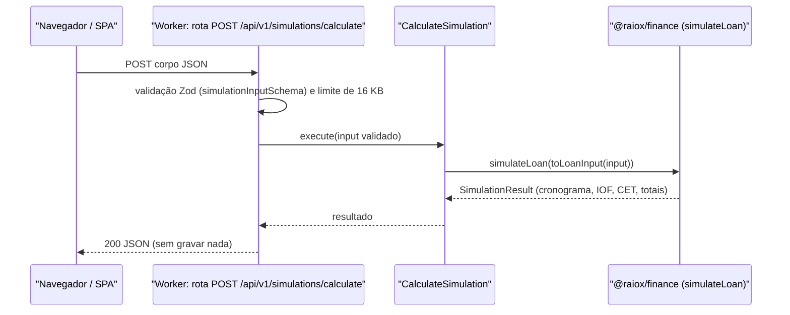

### 7.2 (b) Raio-X de oferta (F2)

`AnalyzeOffer` chama `analyzeOffer`, que resolve a taxa implícita e o CET. Também não tem persistência.

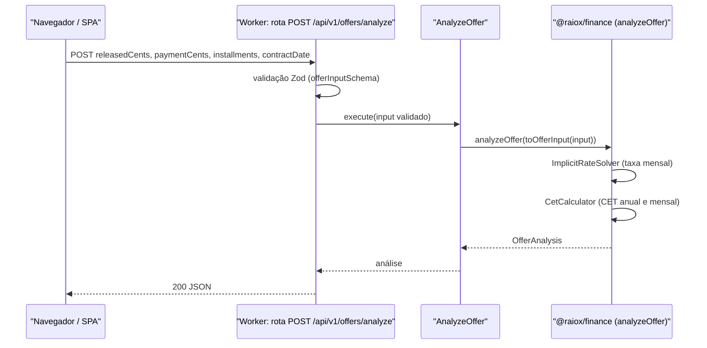

### 7.3 (c) Compartilhar (F4)

`ShareSimulation` valida a entrada pelo domínio antes de gravar. Gera até três ids. Cada tentativa usa `save`, que responde `created` ou `duplicate`. Se as três tentativas colidirem, lança `IdCollisionError`, que vira 500.

A rota aplica o limitador de taxa antes do caso de uso. A validação do corpo acontece antes da rota, então uma requisição inválida não consome o limite. A chave do limitador é o cabeçalho `cf-connecting-ip`, ou `unknown` se ele faltar.

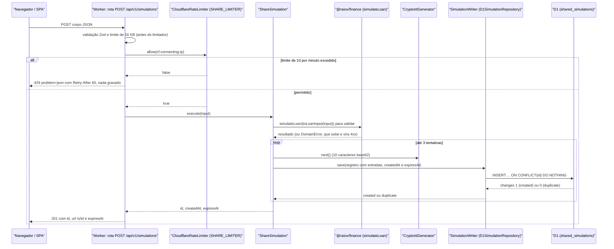

Se as três tentativas forem `duplicate`, `ShareSimulation` lança `IdCollisionError` e a resposta é 500 com a mensagem genérica. Com 62 caracteres e 10 posições, a chance é desprezível, mas o caso é tratado.

Na tela Simular, o botão "Copiar link" (`ShareButton`, visível depois de um resultado) chama `useShare`, que grava a simulação e copia o link com `copyToClipboard`. Se o navegador negar a cópia, o link aparece em um campo selecionável. O botão não existe na tela Raio-X.

### 7.4 (d) Abrir link válido

O navegador pede `GET /s/:id`. O Worker serve a SPA, com status 200, se o id tem o formato certo e existe no D1 sem estar expirado. Assim o HTML já chega pronto, e o cálculo acontece na chamada seguinte à API. `CheckSharedSimulation` só verifica existência e validade. Não recalcula nem revalida as entradas.

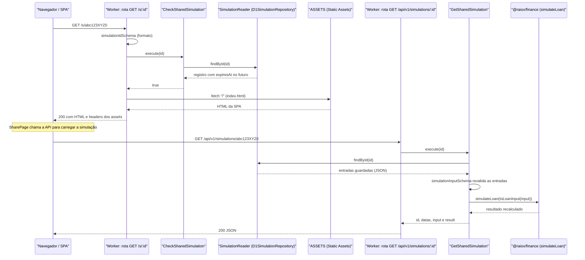

### 7.5 (e) Abrir link expirado ou inexistente

Se o id não tem o formato esperado, a rota responde 404 sem consultar o banco. Se o id tem formato válido mas não existe ou expirou, `CheckSharedSimulation` devolve `false`. Nos dois casos, a resposta traz o mesmo HTML da SPA, com status 404. A SPA então chama a API, que responde 404 em Problem Details. A `SharePage` mostra a `NotFoundPage` com o título "Link expirado" e o botão "Nova simulação".

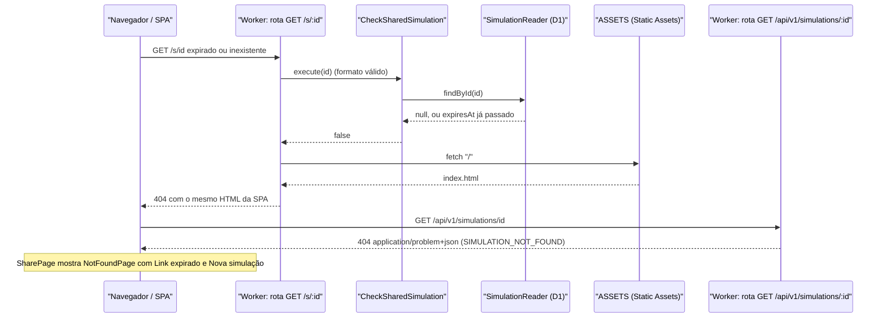

Para um id malformado, por exemplo `a!`, a rota de API responde 404 antes de qualquer consulta ao banco. O comportamento do front é o mesmo.

### 7.6 (f) Limpeza diária por Cron

O Cron Trigger chama `scheduled()` em `apps/api/src/index.ts` uma vez por dia, às 04:17 UTC. O handler cria um `PurgeExpiredSimulations` com o repositório D1 e o relógio do sistema, e executa a limpeza com `ctx.waitUntil`. A limpeza remove as linhas com `expires_at <= agora`, em formato ISO. O registro da quantidade removida fica no log do Worker.

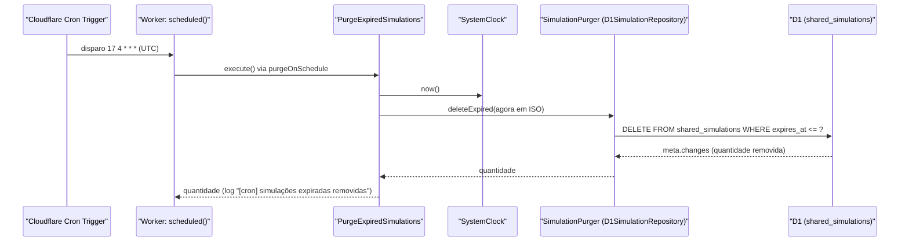

### 7.7 (g) Comparar (F3)

Comparar não tem rota de API própria. Cada cenário usa o cálculo que já existe: uma simulação chama `calculateSimulation` e uma oferta chama `analyzeOffer`. O navegador guarda a lista de cenários em `sessionStorage`, sob a chave `raiox:comparison`. Ao ler essa lista, `parseStoredScenarios` revalida cada item com `simulationInputSchema` ou `offerInputSchema` e descarta os inválidos. Por isso, nada que o usuário tenha editado na aba chega ao cálculo sem passar pelo contrato.

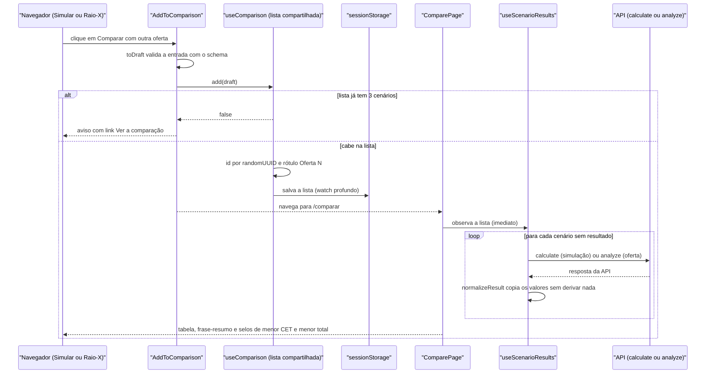

`normalizeResult.ts` só copia valores da resposta: `releasedCents`, `totalPaidCents`, `costCents`, CET mensal e anual, taxa, prazo e a primeira e a última parcela. `bestBy` só compara números que já chegaram e devolve os ids empatados. A frase-resumo e os selos só aparecem com dois ou mais resultados prontos. Um erro de cálculo fica restrito à própria coluna, com o botão "Tentar de novo". Se o `sessionStorage` não existir, a comparação segue só nesta página.

## 8. Dados

### 8.1 Tabela

Só existe uma tabela, criada pela migration `apps/api/migrations/0001_create_shared_simulations.sql`.

| Coluna | Tipo | Restrição | Conteúdo |
|--------|------|-----------|----------|
| `id` | TEXT | PRIMARY KEY | 10 caracteres base62, gerados com `crypto.getRandomValues`. |
| `input_json` | TEXT | NOT NULL | JSON das entradas validadas (`SimulationInput`). Nunca o resultado. |
| `schema_ver` | INTEGER | NOT NULL, DEFAULT 1 | Versão do esquema do registro. Hoje sempre 1. |
| `created_at` | TEXT | NOT NULL | Instante de criação, em ISO-8601 UTC. |
| `expires_at` | TEXT | NOT NULL | Instante de expiração, em ISO-8601 UTC. |

Índice: `idx_shared_expires`, sobre `expires_at`. Ele serve à limpeza diária.

### 8.2 O que é guardado e o que não é

Guardado: as entradas da simulação, a versão do esquema e as duas datas. Não guardado: o cronograma, o CET, o IOF, o nome ou qualquer identificador do usuário. Também não há cookie nem registro de IP. O IP só existe em memória, para a chave do limitador.

Como o resultado não é guardado, uma correção na regra de cálculo vale para todos os links antigos. É a decisão do ADR-006.

### 8.3 Expiração

Cada registro vale 180 dias (`SHARE_TTL_DAYS`). O caso de uso calcula `expiresAt = createdAt + 180 dias` com `addDays`. Um registro é expirado quando `expiresAt <= agora` (`application/dates.ts`, função `isExpired`). Datas inválidas também contam como expiradas, para nunca servir um link cuja validade não se consegue ler.

A limpeza diária remove os vencidos. A checagem de expiração em leitura garante que um link vencido não funcione entre duas limpezas.

### 8.4 Versão do esquema

`schema_ver` e o campo `schemaVersion` do registro são gravados como 1. A leitura, porém, não usa o valor para escolher um caminho de decodificação. Esse é um ponto de extensão (seção 16).

### 8.5 Por que só as entradas (ADR-006)

Se o link guardasse o resultado, uma correção de regra (por exemplo, uma nova alíquota de IOF) deixaria os links antigos com números errados. Guardar só as entradas faz o resultado ser recalculado a cada leitura, com a versão atual do domínio.

## 9. API

### 9.1 Tabela de rotas

Todas as rotas `/api/*` passam pelo middleware de headers (seção 9.4). As rotas `POST` em `/api/v1/*` também passam pelo limite de corpo de 16 KB.

| Método e rota | Entrada | Saída de sucesso | Status possíveis |
|---------------|---------|------------------|------------------|
| `POST /api/v1/simulations/calculate` | `simulationInputSchema` (JSON) | 200, `simulationResultSchema` | 400 (JSON malformado), 413 (corpo acima de 16 KB), 422 (validação ou erro de domínio `INVALID_INPUT`, `TAX_POLICY_NOT_FOUND` ou `NON_CONVERGENCE`), 500 |
| `POST /api/v1/offers/analyze` | `offerInputSchema` (JSON) | 200, `offerAnalysisSchema` | 400, 413, 422, 500 |
| `POST /api/v1/simulations` | `simulationInputSchema` (JSON) | 201, `{ id, url, expiresAt }` | 400, 413, 422, 429 (com `Retry-After: 60`), 500 (inclui `ID_COLLISION`) |
| `GET /api/v1/simulations/{id}` | `id` no caminho | 200, `sharedSimulationSchema` (`id`, `createdAt`, `expiresAt`, `input`, `result`) | 404 (inexistente, expirada ou malformada), 500 (`STORED_SIMULATION_INVALID` ou erro interno) |
| `GET /api/health` | nenhuma | 200, `{ "status": "ok" }` | 200 |
| `GET /api/openapi.json` | nenhuma | 200, documento OpenAPI 3.1.0 | 200 |
| `GET /api/docs` | nenhuma | 200, HTML da interface Scalar | 200 |
| `GET /s/:id` | `id` no caminho | 200, HTML da SPA | 200 (link válido) ou 404 (inexistente ou expirado), com o mesmo HTML |
| Qualquer `/api/*` não listado | nenhuma | nenhuma | 404, `route-not-found` |

A rota `/s/:id` não é uma rota de API. Ela só decide o status da resposta e devolve o HTML da SPA. Ela não usa Problem Details.

### 9.2 Formato de erro (RFC 9457)

Todo erro de `/api/*` vira `application/problem+json`. O `type` tem o formato `urn:raiox:problem:<slug>`. O `status` é o próprio status HTTP. Os campos `code` e `errors[]` aparecem quando se aplicam. O `code` vem do erro de domínio. O `errors[]` traz `path` (campo, com pontos para subcampos) e `message` (pt-BR).

### 9.3 Mapeamento erro para status, type e code

`handleError` (`http/problem/errorHandler.ts`) traduz qualquer erro lançado.

| Origem do erro | Status | `type` (slug) | `title` | `code` |
|----------------|--------|---------------|---------|--------|
| `ProblemError` (criado pela rota) | o do problema | o do problema | o do problema | o do problema |
| Validação Zod (`validationHook`) | 422 | `validation` | Dados inválidos | não |
| JSON malformado (`HTTPException` 400) | 400 | `malformed-json` | Requisição malformada | não |
| Corpo acima de 16 KB | 413 | `payload-too-large` | Corpo muito grande | não |
| Rota `/api/*` desconhecida | 404 | `route-not-found` | Rota não encontrada | não |
| Limitador negou | 429 | `rate-limited` | Muitas requisições | não |
| Outra `HTTPException` | o próprio status | `http-error` | Requisição inválida | não |
| `SIMULATION_NOT_FOUND` | 404 | `simulation-not-found` | Simulação não encontrada | `SIMULATION_NOT_FOUND` |
| `INVALID_INPUT` | 422 | `invalid-input` | Entrada inválida | `INVALID_INPUT` |
| `TAX_POLICY_NOT_FOUND` | 422 | `tax-policy-not-found` | Política de tributos indisponível | `TAX_POLICY_NOT_FOUND` |
| `NON_CONVERGENCE` | 422 | `non-convergence` | Cálculo não convergiu | `NON_CONVERGENCE` |
| `STORED_SIMULATION_INVALID`, `ID_COLLISION`, outros códigos de domínio | 500 | `internal-error` | Erro interno | não (mensagem não exposta) |
| Qualquer outro erro | 500 | `internal-error` | Erro interno | não (registrado com `console.error`) |

Erros 500 nunca expõem a mensagem original. O `detail` genérico é "Não foi possível concluir a requisição. Tente novamente mais tarde.".

### 9.4 Headers de segurança e limite de corpo

- `/api/*` (exceto `/api/docs`): `secureHeaders` com `Content-Security-Policy: default-src 'none'; frame-ancestors 'none'`, mais `X-Content-Type-Options: nosniff` e `Cache-Control: no-store`.
- `/api/docs`: `secureHeaders` padrão, sem CSP restritiva, para que a interface Scalar carregue. O teste `systemRoutes.test.ts` confirma que essa rota não tem CSP.
- `POST` em `/api/v1/*`: limite de 16 KB (`MAX_BODY_KILOBYTES`), com resposta 413 em Problem Details.
- `GET /s/:id`: resposta com `Cache-Control: no-store`, porque o status muda quando o link expira.

### 9.5 OpenAPI e Scalar

`OPENAPI_DOCUMENT` (`http/openapi/documentConfig.ts`) define a versão 3.1.0, o título "Raio-X do Empréstimo API", a versão 1.0.0 e três tags: Simulações, Raio-X de oferta e Sistema. A rota `doc31` publica o documento em `/api/openapi.json`. A rota `/api/docs` usa `@scalar/hono-api-reference`, que lê esse documento.

As definições de rota (`http/definitions/*.ts`) usam `createRoute` do `@hono/zod-openapi`. Os schemas de corpo e de resposta são os de `@raiox/contracts`. Os exemplos vêm de `definitions/examples.ts` e reproduzem os critérios de aceite da SPEC. Os erros comuns são documentados em `responses.ts`.

O `validationHook` substitui a resposta padrão de validação do Hono (400) por 422 em Problem Details. Essa escolha aparece na seção 15.

## 10. Front-end

### 10.1 Organização por feature

```
apps/web/src/
  app/        App.vue, main.ts, router.ts, NotFoundPage.vue
  features/
    simulate/  SimulatePage, SimulationForm, SimulationOptions, Carne, CarneSlip,
               ResultSummary, ScheduleTable, useSimulation, simulationForm, formFocus
    analyze/   AnalyzePage, OfferForm, OfferResult, useOfferAnalysis, offerForm
    share/     SharePage, ShareButton, useShare, useSharedSimulation, sharedSummary, clipboard
    compare/   ComparePage, AddOfferSection, ComparisonTable, AddToComparison,
               useComparison, useScenarioResults, scenario, comparisonStorage,
               normalizeResult, bestBy, comparisonRows, comparisonSummary
  shared/
    api/       client.ts, http.ts, errors.ts, problems.ts
    useValidatedRequest.ts, focusFirstInvalid.ts, format.ts, today.ts
  design/
    tokens.css, base.css, fieldAttrs.ts, useFormattedInput.ts
    components/  BaseButton, BaseField, CompositionBar, DateInput, IntegerInput,
                 MoneyInput, PercentInput, SegmentedControl, TermHint
```

Cada feature contém suas páginas, componentes e composables. Nada é compartilhado entre features, exceto o que está em `shared` e `design`.

### 10.2 Rotas

`router.ts` define `/` (simular), `/raio-x`, `/comparar`, `/s/:id` e um catch-all para `NotFoundPage`. O título da aba vem de `meta.title` e é aplicado em `afterEach`, com o sufixo "Raio-X do Empréstimo".

### 10.3 Composables no lugar de store global

Não há store global (Pinia ou similar). Cada tela cria seu estado com um composable. A única exceção é a lista da comparação, que fica em `useComparison.ts` como um `ref` de módulo sincronizado com o `sessionStorage`, para que as telas Simular, Raio-X e Comparar enxerguem a mesma lista na aba:

- `useSimulation()` cria um `reactive` com o formulário, inicializado com a data de hoje, e chama `useValidatedRequest` com o schema `simulationInputSchema`. Expõe `load(input)`, que preenche o formulário a partir de uma simulação compartilhada para edição.
- `useOfferAnalysis()` segue o mesmo padrão, com `offerInputSchema`.
- `useShare()` controla o status do compartilhamento: `idle`, `loading`, `copied`, `manual` ou `error`.
- `useSharedSimulation(getId)` carrega a simulação compartilhada e tem os status `loading`, `success`, `not-found` ou `error`. Cancela a requisição anterior ao recarregar.

O `useValidatedRequest` (`shared/useValidatedRequest.ts`) concentra a mecânica comum. Ele valida o formulário com o schema, chama a API com um `AbortSignal`, cancela a chamada anterior e mapeia os erros para os campos. Depois do primeiro envio, qualquer alteração recalcula com debounce de 400 ms. A primeira mensagem de cada campo é a que aparece. Um erro 422 da API só vira erro de campo se o campo for conhecido. Os demais viram mensagem geral.

- `useComparison()` expõe `scenarios`, `add`, `remove`, `rename` e `clear`. A lista tem no máximo `MAX_COMPARE_SCENARIOS` itens.
- `useScenarioResults(scenarios)` busca o resultado de cada cenário e guarda o estado (`loading`, `ready` ou `error`) por id. Remover um cenário apaga o estado dele.

O `useValidatedRequest` (`shared/useValidatedRequest.ts`) é o composable genérico de validação e envio. Ele é usado por `useSimulation` (Simular) e `useOfferAnalysis` (Raio-X). O formulário de cada tela fornece só o schema, o formulário e a chamada à API.

### 10.4 Cliente da API tipado pelos contratos

`shared/api/client.ts` expõe uma função por rota (`calculateSimulation`, `analyzeOffer`, `shareSimulation` e `getSharedSimulation`). Os tipos de entrada e de saída vêm de `@raiox/contracts`.

`shared/api/http.ts` faz a chamada com `fetch` para `/api/v1`. Os erros viram `ApiError` (`shared/api/errors.ts`), que carrega o `Problem`. Quando o corpo de erro não é um Problem válido, `problems.ts` gera um problema genérico em pt-BR a partir do status. Falha de rede vira status 0, com a mensagem "Não foi possível conectar". Cancelamentos (`AbortError`) são repassados sem alteração.

O cliente não valida o corpo de sucesso em tempo de execução. A tipagem é só estática, com um cast. A validação de entrada acontece antes do envio, com os mesmos schemas da API.

### 10.5 Validação no cliente

O formulário é validado com `simulationInputSchema` ou `offerInputSchema` antes de qualquer chamada. A função `toCandidate` converte o formulário no objeto cru, e data vazia vira campo ausente, para que o default ou a mensagem do schema seja usado. Os campos de valor usam componentes que formatam em pt-BR (`MoneyInput`, `PercentInput`, `IntegerInput`, `DateInput`), com `useFormattedInput`.

Como o front não importa `@raiox/finance`, ele nunca calcula. Todo número mostrado vem da API.

### 10.6 Design system "Carnê"

O design system fica em `apps/web/src/design` e não usa biblioteca de UI pronta (ADR-005). Conceito e escolhas estão em `docs/DESIGN.md`. Os tokens estão em `tokens.css` como variáveis CSS em `:root`: cores (papel `#E9F0EC`, lâmina `#F8FBF9`, tinta `#1B2A41`, juros, amortização, encargos e picote), escala tipográfica modular de 1,25 (14 a 39 px), espaçamento, raios e tamanho mínimo de alvo de 44 px.

O que é ousado: o carnê. Cada parcela é uma lâmina (`CarneSlip.vue`), com picote entre as lâminas e uma barra de composição (`CompositionBar.vue`) que mostra juros, amortização e encargos. A frase de resultado ("Você recebe ... e devolve ...") fica em destaque em `ResultSummary.vue`.

O que é quieto: formulário, navegação e rodapé. Não há cards, sombras decorativas nem gradientes. A única elevação é a borda de picote das lâminas.

A fonte é Atkinson Hyperlegible Next, instalada como pacote `@fontsource` e importada em `main.ts` nos pesos 400, 700 e 800. Os arquivos ficam no próprio bundle, o que mantém as fontes sob `font-src 'self'`. O `DESIGN.md` cita o Google Fonts como origem, mas o código não o usa (seção 16).

### 10.7 Lista longa de parcelas

`Carne.vue` mostra todas as lâminas quando há até 24. Com mais de 24, mostra as 6 primeiras, um separador "… N parcelas …" e as 3 últimas. O botão "Ver todas as parcelas" alterna a `ScheduleTable` completa, com `aria-expanded` e `aria-controls`.

### 10.8 Acessibilidade (o que existe no código)

- Link "Pular para o conteúdo" (`App.vue`), que aponta para `#conteudo`.
- Ao trocar de rota, o foco vai para o `h1` da página (`App.vue`, com `tabindex="-1"` nos títulos).
- A navegação principal tem `aria-label="Principal"`. A página atual recebe estilo por `aria-current`.
- Resultados atualizados ficam em regiões `aria-live="polite"` com `aria-atomic="true"`: `ResultSummary.vue`, `OfferResult.vue` e o status do `ShareButton.vue`.
- Erros gerais aparecem com `role="alert"`.
- Campos com erro recebem `aria-invalid="true"` e `aria-describedby` apontando para a mensagem (`MoneyInput`, `PercentInput`, `IntegerInput` e `DateInput`).
- `focusFirstInvalid` leva o foco ao primeiro campo inválido. Se o campo está dentro de um `details` fechado, abre o `details` antes.
- `TermHint.vue` explica termos como CET com um `details` e `summary`, que funcionam com teclado sem depender de hover.
- `CompositionBar` tem `role="img"` com uma descrição textual, e a legenda traz os valores.
- `ScheduleTable` é uma região rolável com `aria-label` e `tabindex="0"`.
- O `Carne` usa `ol` com `aria-label="Parcelas"`. O separador de parcelas omitidas tem `role="presentation"`.
- `prefers-reduced-motion` desliga as animações em `base.css` e em `CarneSlip.vue`.
- A página declara `lang="pt-BR"` (`index.html`) e tem um `noscript` com o aviso de que é preciso JavaScript.

### 10.9 Tela Comparar (F3)

- Rota `/comparar`, com o título "Compare até 3 ofertas". Sem cenários, mostra um convite e um link para a tela Simular. O formulário de oferta (`AddOfferSection`, que reaproveita o `OfferForm` do Raio-X) aparece aberto.
- Cada cenário é uma coluna da `ComparisonTable`. O cabeçalho tem um campo de nome (editável, máximo de 60 caracteres), um botão "Remover" com nome acessível e o estado do cálculo: "Calculando…" em `role="status"`, ou erro com "Tentar de novo".
- As linhas vêm de `COMPARISON_ROWS`, nesta ordem: valor recebido, parcela (ou faixa da primeira à última), prazo, taxa ao mês, CET ao mês, CET ao ano, total pago e custo do crédito.
- Os selos "Menor CET" e "Menor total pago" aparecem nas células vencedoras. São texto com borda, não só cor. Empates recebem o selo em todas as colunas empatadas.
- A frase-resumo fica em `aria-live="polite"` e usa `buildComparisonSummary`, que devolve nulo com menos de dois resultados prontos.
- A tabela tem `role="region"` com `aria-label` e `tabindex="0"`, e rola na horizontal com largura mínima de 36 rem.
- O botão "Comparar com outra oferta" (`AddToComparison`) fica nas telas Simular e Raio-X. Com três cenários, mostra o aviso "Você já tem 3 ofertas na comparação" e um link para a tela.

## 11. Segurança e privacidade

- Validação de entrada: toda entrada passa pelo schema do `@raiox/contracts` antes de chegar ao caso de uso. Objetos são estritos, então chaves desconhecidas são rejeitadas. Datas precisam existir no calendário.
- Domínio como última barreira: `ShareSimulation` roda `simulateLoan` antes de gravar. Uma entrada que o domínio rejeita nunca vai para o banco.
- Prepared statements: os três comandos SQL de `D1SimulationRepository` usam `prepare` e `bind`. O teste `D1SimulationRepository.test.ts` confirma que um id com aspas e `OR '1'='1'` não devolve registros.
- Id do link: 10 caracteres base62, gerados com `crypto.getRandomValues`. A amostragem rejeita bytes acima de 248, para evitar viés de módulo. Um id malformado nem chega ao banco.
- Limites: corpo de 16 KB em `POST /api/v1/*`, limite de 1 a 420 parcelas e teto de valor da R7. O limite de tamanho de corpo também vale para os cálculos.
- Rate limit: `POST /api/v1/simulations` aceita 10 pedidos por minuto por IP, pelo binding `SHARE_LIMITER`. Excedido, responde 429 com `Retry-After: 60`. Se o binding lançar erro, o adaptador registra um aviso e permite a requisição (falha aberta): a indisponibilidade do limitador não derruba o compartilhamento.
- Nenhum dado pessoal: a tabela não guarda nome, documento, e-mail nem IP. O IP é usado só como chave de limite, em memória. Os logs de erro não incluem as entradas do usuário.
- CSP da API: `default-src 'none'`, `frame-ancestors 'none'`. CSP da SPA, em `apps/web/public/_headers`: `default-src 'self'`, `script-src 'self'`, `style-src 'self'`, `style-src-attr 'unsafe-inline'`, `img-src 'self' data:`, `font-src 'self'`, `connect-src 'self'`, `base-uri 'self'`, `form-action 'self'` e `frame-ancestors 'none'`. Também há `X-Content-Type-Options: nosniff` e `Referrer-Policy: strict-origin-when-cross-origin`.
- Sem CORS: não há middleware de CORS. A SPA e a API têm a mesma origem, o que é a decisão do ADR-003.
- Erros internos não vazam: o teste de rota confirma que a mensagem "segredo interno do banco" não aparece na resposta 500.

## 12. Desempenho

- Orçamento: a ADR-001 fixa 10 ms de CPU por requisição no plano gratuito. A SPEC, seção 5, fixa a meta de 5 ms para 420 parcelas.
- Complexidade: o cronograma é O(n) com n até 420. O IOF financiado faz no máximo 100 iterações de `planSchedule`, cada uma O(n). O CET faz no máximo 100 iterações de Newton, com bisseção de até 100 iterações como fallback, cada uma O(n). A busca do limite superior faz no máximo cerca de 60 duplicações para 1e18. Todos os limites são constantes, então o custo máximo é limitado por produto de constantes e n.
- Benchmark: `packages/finance/src/loan/perf.test.ts` roda a simulação completa de 420 parcelas, com IOF financiado, tarifas e CET, após 5 execuções de aquecimento. Ela mede a média de 50 execuções e exige menos de 5 ms. Um segundo teste mede o CET isolado com 420 fluxos e exige a mesma média.
- O que foi evitado em tempo de execução:
  - A API não revalida a saída com o schema de resposta. O `asMutable` apenas troca o tipo, sem copiar.
  - `GET /s/:id` não recalcula nada. Ele só verifica existência e validade.
  - Não há cache de resultados. A leitura recalcula sempre, por design (ADR-006).
  - Para compartilhar, o caso de uso calcula a simulação uma vez para validar. Não há um segundo cálculo para o link.
  - O formulário espera 400 ms antes de recalcular (`useValidatedRequest`), e cancela a chamada anterior.
  - Quando há mais de 24 parcelas, a web renderiza 9 lâminas (6 primeiras e 3 últimas) e a tabela completa só sob demanda.

## 13. Estratégia de testes

| Nível | Onde | Ferramenta | O que testa |
|-------|------|------------|-------------|
| Domínio | `packages/finance/src/**/*.test.ts` | Vitest com cobertura v8 | Valores de referência das regras R1 a R6 e os critérios de aceite 1 a 4 da SPEC (`loan/simulateLoan.test.ts`), CET (`cet/CetCalculator.test.ts`), taxa implícita, IOF financiado, datas e o benchmark de `perf.test.ts`. A cobertura exige 95% em linhas, funções, ramos e instruções. |
| Contratos | `packages/contracts/src/*.test.ts` (7 arquivos) | Vitest | Limites da R7, mensagens em pt-BR, parse de entradas e formato dos schemas de saída. |
| Casos de uso | `apps/api/src/application/usecases/*.test.ts` | Vitest com fakes | Fluxos completos com `InMemorySimulationRepository`, `FixedClock`, `SequenceIdGenerator` e `FakeRateLimiter`. Cobre a expiração em 180 dias ao milissegundo, as colisões de id e a revalidação de dados corrompidos. |
| Infraestrutura | `apps/api/src/infrastructure/*.test.ts` | Vitest | `CryptoIdGenerator` com fonte de bytes injetável. `CloudflareRateLimiter` com binding falso. `SystemClock`. |
| Repositório D1 | `apps/api/src/infrastructure/D1SimulationRepository.test.ts` | Vitest com Miniflare | Um D1 local real. O teste aplica a migration `0001` lendo o arquivo SQL, e verifica `INSERT ... ON CONFLICT`, JSON corrompido, limpeza e SQL injection. |
| HTTP | `apps/api/src/http/**/*.test.ts` | Vitest com `app.request` | Rotas reais sobre o harness (`http/testing/harness.ts`), com fakes nos ports. Cobre status, Problem Details, headers, limite de corpo, rate limit e a página `/s/:id`. |
| Componentes e composables da web | `apps/web/src/**/*.test.ts` | Vitest com jsdom e `@vue/test-utils` | `Carne`, `ScheduleTable`, `ResultSummary`, `SimulationForm`, `SimulatePage`, `OfferResult`, `SharePage`, `useShare`, `useSimulation`, `useOfferAnalysis` e o cliente da API (`client.test.ts`). |
| Comparar | `apps/web/src/features/compare/*.test.ts` | Vitest com jsdom e `@vue/test-utils` | `AddToComparison`, `ComparePage` e `useComparison`: adição, limite de três cenários e persistência na lista. |

O pipeline local roda `pnpm -r lint && pnpm -r typecheck && pnpm -r test`. O lint usa ESLint com regras de `strictTypeChecked`. O typecheck usa `tsc` na API e no domínio e `vue-tsc` na web.

## 14. Implantação

### 14.1 Um Worker

O sistema é um Worker chamado `raiox`, com `main` em `apps/api/src/index.ts`. O mesmo deploy serve a API, os links `/s/:id` e os arquivos da SPA. Essa é a decisão do ADR-003. Não há Pages separado nem CORS.

### 14.2 Configuração (`apps/api/wrangler.jsonc`)

| Chave | Valor | Função |
|-------|-------|--------|
| `name` | `raiox` | Nome do Worker. |
| `main` | `src/index.ts` | Ponto de entrada. |
| `compatibility_date` | `2026-11-01` | Versão de compatibilidade do runtime. |
| `d1_databases` | binding `DB`, banco `raiox-db`, id `5832dfed-df38-4666-8082-f7f67f555446`, `migrations_dir` `migrations` | Banco D1 e migrations (região ENAM). |
| `assets` | `directory` `../web/dist`, binding `ASSETS`, `not_found_handling` `single-page-application`, `run_worker_first` `["/api/*", "/s/*"]` | Arquivos da SPA e fallback. |
| `triggers.crons` | `["17 4 * * *"]` | Limpeza diária às 04:17 UTC. |
| `ratelimits` | `SHARE_LIMITER`, `namespace_id` `1001`, limite 10 por 60 s | Limite de compartilhamento. |
| `observability` | habilitada | Logs do Worker. |
| `upload_source_maps` | `true` | Mapas de origem no envio. |

O `apps/web/dist` precisa existir antes do `wrangler deploy`, porque é a pasta de assets. O `build` da raiz (`pnpm -r build`) gera esse diretório.

### 14.3 Migrations

Os scripts de `apps/api/package.json` são `db:migrate:local` (`wrangler d1 migrations apply raiox-db --local`) e `db:migrate:remote` (a mesma coisa com `--remote`). A migration `0001` é a única hoje.

### 14.4 CI/CD (GitHub Actions)

Dois workflows ficam em `.github/workflows/`.

`ci.yml` (nome CI) roda em `pull_request` e também pode ser chamado por outro workflow (`workflow_call`). Tem um único job, `check`, em `ubuntu-latest`, com timeout de 15 minutos, permissão somente de leitura e concorrência por ref, que cancela execuções antigas. Os passos são: checkout; pnpm, sem versão fixa, porque a action lê o campo `packageManager` do `package.json`; Node, pela versão do `.nvmrc`, com cache de pnpm; `pnpm install --frozen-lockfile`; `pnpm format:check`; `pnpm lint`; `pnpm typecheck`; `pnpm test`; build da web (`pnpm --filter @raiox/web build`), necessário porque o Worker serve `../web/dist`; e um dry-run do bundle do Worker (`wrangler deploy --dry-run`), que valida o bundle sem publicar e sem credenciais.

`deploy.yml` (nome Deploy) roda em push na `main` e por `workflow_dispatch`. Tem dois jobs:

- `verify` chama o `ci.yml` inteiro (`uses: ./.github/workflows/ci.yml`).
- `deploy` depende de `verify` e usa o ambiente `production`, cuja URL vem do passo de publicação. Usa a concorrência `deploy-production` sem cancelamento, para que os deploys entrem em fila. Os secrets `CLOUDFLARE_API_TOKEN` e `CLOUDFLARE_ACCOUNT_ID` ficam só nesse job.

Os passos do `deploy`, em ordem: checkout, pnpm, Node e instalação; build da web; migrations do D1 remoto (`wrangler d1 migrations apply raiox-db --remote`); publicação (`wrangler deploy`, com a saída gravada em `deploy.log`, de onde a URL `*.workers.dev` é extraída; se a URL não aparecer, o job falha); e smoke test, com `curl --retry 10` em `$APP_URL/api/health` e em `$APP_URL/`.

A ordem é: verificações, build da web, migrations, `wrangler deploy` e smoke test. As migrations rodam antes da publicação porque o código novo espera o schema novo. Não há rollback automático de migration.

### 14.5 Cron

O Cron Trigger chama `scheduled()`. A limpeza roda como descrito na seção 7.6. Falhas não têm retentativa, e o resultado é só um log.

## 15. Decisões de projeto

### 15.1 ADRs existentes

| ADR | Decisão | Como aparece no código |
|-----|---------|------------------------|
| 001 | Cloudflare Workers e D1, em vez de host gratuito de PHP ou Docker. | Um Worker, D1 e Cron. Orçamento de 10 ms de CPU, coberto por `perf.test.ts`. |
| 002 | Dinheiro em centavos inteiros, taxas em `number` com solver, arredondamento por parcela com resíduo na última. | `Money`, `roundHalfEven`, `findRoot`, resíduo na última linha de Price e SAC. Ver a divergência da seção 16. |
| 003 | Um Worker servindo API e front. | `run_worker_first` e fallback de assets. Sem CORS. |
| 004 | Schemas Zod compartilhados entre API e web. | `@raiox/contracts` usado pelas rotas, pelo OpenAPI e pelos formulários. |
| 005 | Design system próprio. | `apps/web/src/design`, sem biblioteca de UI. |
| 006 | Link guarda só as entradas. | `shared_simulations.input_json` e o recálculo em `GetSharedSimulation`. |

### 15.2 Decisões tomadas na implementação

- Ports divididos: a ARCHITECTURE fala em um `SimulationRepository`, mas o código tem `SimulationWriter`, `SimulationReader` e `SimulationPurger`. Cada caso de uso depende só do que usa, o que segue o princípio da segregação de interfaces.
- Erros 422 para validação: o `validationHook` devolve 422 em Problem Details no lugar do 400 padrão do Hono, e o 400 fica reservado para JSON malformado (conforme os testes de rota).
- Type em `urn:raiox:problem:<slug>`: o `type` do Problem é uma URN, não uma URL. O código não comenta essa escolha; o slug agrupa os tipos de erro.
- Mesmo HTML para 200 e 404 em `/s/:id`: o front decide a mensagem, então a resposta HTTP só marca o status (comentário em `sharedPageRoute.ts`).
- Id malformado vira 404 sem consulta ao banco: a checagem por `simulationIdSchema` vem antes do caso de uso (comentário em `simulationRoutes.ts`).
- Chave do limitador: o IP vem de `cf-connecting-ip`, e a falta do cabeçalho cai em `unknown`.
- Registro corrompido vira `null` e depois `STORED_SIMULATION_INVALID`, sem derrubar a leitura. O JSON inválido é tratado no repositório (comentário em `D1SimulationRepository.ts`).
- Composição a cada requisição: `buildServices` cria as instâncias por requisição, o que é barato, e deixa o `createApp` independente de bindings concretos.
- Tipos mutáveis: `asMutable` converte os tipos `readonly` do domínio para os tipos mutáveis dos schemas, sem copiar (comentário em `mutable.ts`).
- Política de IOF a partir de 2022: a versão única cobre contratos a partir dessa data. Versões anteriores não são modeladas (comentário em `taxPolicies.ts`).
- Fontes self-hosted com `@fontsource`, o que mantém a CSP `font-src 'self'`.
- Estado por composable, sem store, conforme a ARCHITECTURE. A lista da comparação é a única exceção, por precisar atravessar telas.
- Comparação sem API própria: reaproveita as rotas de cálculo, e a lista fica só no navegador (`sessionStorage`), sem conta nem persistência no servidor.
- Ids de cenário por `randomUUID`. O rótulo "Oferta N" é o menor número livre, sem repetir um nome já usado.
- `normalizeResult` não deriva valores (comentário no arquivo). Os selos só comparam números recebidos da API.
- Link `/s/:id` confere só existência e validade, e a API revalida as entradas na leitura. É uma decisão: a página só decide o status, e o cálculo fica em um lugar. A consequência está na seção 16.2.
- Limitador com falha aberta (`CloudflareRateLimiter`) e `Cache-Control: no-store` em `/s/:id` (`sharedPageRoute`).

## 16. Riscos, limitações e evolução

### 16.1 Divergências entre documentos e código

| Tema | Documento | Código | Impacto |
|------|-----------|--------|---------|
| IOF com NONE ainda exige política vigente | SPEC, R3: IOF só existe quando aplicado. | `buildContext` chama `taxPolicyFor` mesmo com `iofMode` `NONE`. Contrato anterior a 2022 responde 422 `TAX_POLICY_NOT_FOUND` sem IOF. | Médio. A correção é chamar `taxPolicyFor` só quando `applyIof` for verdadeiro. |
| Arredondamento | ADR-002: "só na fronteira de cada parcela". | Juros por linha, IOF diário somado sem arredondar e arredondado uma vez no total. | Baixo, a divergência está na descrição, não na lógica. A ADR deve ser ajustada. |
| Precisão | SPEC seção 5: "bigint-safe até 10^13". | Nenhum `bigint`. O código usa `number` com `Number.isSafeInteger` (até 2^53). O teto de R7 é 10^9 centavos. | Baixo. A SPEC deve citar o teto de R7. |
| Resposta de POST /api/v1/simulations | ARCHITECTURE: `{ id, url }`. | `{ id, url, expiresAt }`. | Baixo. Contrato mais rico, compatível. |
| Fonte | DESIGN: "Google Fonts". | `@fontsource` self-hosted. | Baixo. A implementação é mais adequada à CSP. |

### 16.2 Riscos técnicos

- Link com registro corrompido: como `/s/:id` só confere existência, ele devolve 200 mesmo quando a API depois falha ao revalidar. A API responde 500 `STORED_SIMULATION_INVALID`, e a SPA mostra "Não foi possível abrir a simulação", e não "Link expirado". É a consequência da decisão da seção 15.2.
- Cabeçalhos de `/s/:id`: o Worker não aplica `apiHeaders` a `/s/*`. Os headers da SPA vêm do `_headers` do ASSETS, mas o teste usa um fake (`FakeAssets`). O comportamento real deve ser confirmado no teste de fumaça.
- Limitador: o binding de rate limit é um limite aproximado. Vale confirmar na documentação da Cloudflare se o contador é local a cada data center. Não há limite nos endpoints de cálculo, que dependem do limite de corpo e do teto de 420 parcelas. Em caso de erro do binding, o limitador falha aberto (seção 11).
- Testes de desempenho com tempo de parede: `perf.test.ts` exige média abaixo de 5 ms. Em uma máquina carregada, o teste pode falhar sem regressão real.
- Teste de repositório desatualizado: `D1SimulationRepository.test.ts` usa um objeto de entrada com as chaves `amount` e `termMonths`, com `as unknown`. O teste passa, mas não reflete o contrato atual.
- Cliente sem validação de sucesso: a web confia no formato da resposta de sucesso. Uma mudança no contrato da API só aparece em tempo de execução, na tela.
- Cron sem retentativa: uma falha na limpeza só aparece no log. Os links vencidos continuam sem funcionar, porque a leitura verifica a expiração.
- Limites do plano gratuito: o Worker tem orçamento de CPU por requisição, e o D1 tem cotas diárias de leitura e escrita. Os valores atuais devem ser conferidos na documentação da Cloudflare antes de um aumento de tráfego.

### 16.3 Fora do escopo da v1

Login e histórico por usuário, carência, taxas pós-fixadas, financiamento imobiliário (SFH e SFI), consignado com margem (SPEC, seção 3). Também ficam de fora o tratamento de encargos em `charges` (sempre zero).

### 16.4 Pontos de extensão

- Novo sistema de amortização: criar uma classe que implementa `AmortizationStrategy`, adicionar ao mapa de `strategyFor`, incluir o valor em `AmortizationSystem` e em `amortizationSystemSchema`. Nenhum código existente muda.
- Nova versão da política de IOF: acrescentar uma entrada em `TAX_POLICIES` com nova `validFrom`, em ordem crescente. O algoritmo não muda.
- Nova versão do esquema dos links: incrementar `SCHEMA_VERSION` em `ShareSimulation` e tratar `schema_ver` em `GetSharedSimulation`, que hoje não se ramifica por versão. Registros antigos continuam legíveis enquanto a versão 1 for suportada.
- Novo tipo de cenário na comparação: estender `ScenarioKind` e criar um `fromX` em `normalizeResult.ts`, sem alterar a tabela nem os selos.
